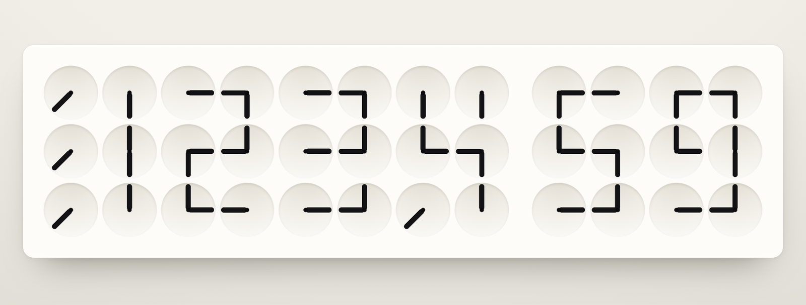
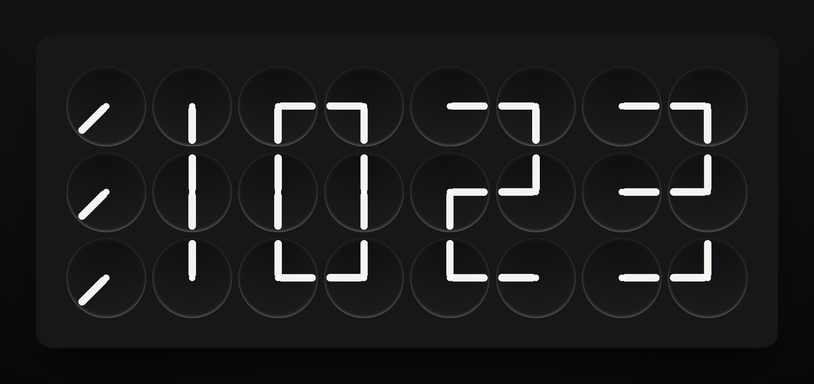
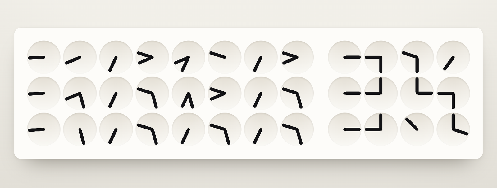
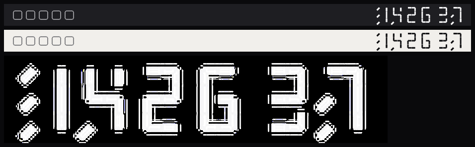

# ClockClock · 时:分:秒

在 24 表盘的基础上把秒补到末尾：**36 个表盘、72 根指针**拼出 HH:MM:SS。

- 时:分换字：指针顺时针兜一整圈，**15 秒**慢慢转到位；
- 秒位：每 1 秒动一次，**0.8 秒**转完、停 0.2 秒等下秒；
- 时:分 与 秒之间留一道冒号宽的空隙，六位数字才不会糊成一片。

单文件 HTML，零依赖零构建，双击就能跑；外加一个原生 macOS 状态栏版。

**在线体验：** <https://cooperzhuang.github.io/clockclock-24/>  
**下载 App：** [Releases](https://github.com/CooperZhuang/clockclock-24/releases) —— 状态栏版，macOS 13+，只出 dmg：通用版（Apple Silicon + Intel）和 Apple Silicon 专版各一个





转动的过程（截图定格）：



## 灵感来源

这个项目是在复刻 **ClockClock 24** —— 瑞典工作室 **Humans Since 1982**（Per Emanuelsson & Bastian Bischoff）的作品：24 个表盘、48 根指针，每块盘里两根针各自转到某个角度，一起凑出 HH:MM。原作是壁挂式动态雕塑，限量制作，在 MoMA Design Store 等设计商店发售过。

- 工作室官网：<https://www.humanssince1982.com/>
- 最初照着做的是一张实拍照片：白面板、浅灰凹碗表盘、纯黑指针
- 本项目与 Humans Since 1982 无关，是非官方的个人致敬；表盘、指针、字形都是按自己理解重画的，源码 MIT

原作只显示到分钟；这里的网页版和状态栏版把秒补到了末尾（36 个表盘 / 72 根指针），这是本项目自己的延伸。

## 安装（macOS 状态栏版）

从 [Releases](https://github.com/CooperZhuang/clockclock-24/releases) 下载：

| 包 | 适用 |
| --- | --- |
| `ClockClock-1.2.1.dmg` | 通用版，Apple Silicon + Intel |
| `ClockClock-1.2.1-arm64.dmg` | Apple Silicon 专版，体积小一半左右 |

打开 dmg 把 `ClockClock.app` 拖进「应用程序」，打开后菜单栏右侧就会出现时钟。

### 首次打开被拦怎么办

这些包是 **ad-hoc 签名、没有做苹果公证**——公证要 Apple Developer Program（99 美元/年），个人项目没买。所以从浏览器下载的 dmg 解出来的 app 带 quarantine 标记，首次打开会被 Gatekeeper 拦。

**macOS 15 起右键「打开」的捷径已经被取消**，正确做法是：

1. 先双击一次 ClockClock.app，看到「无法验证开发者」的提示后关掉
2. 打开「系统设置 → 隐私与安全性」，拉到最下面，点「仍要打开 ClockClock」
3. 再启动一次，弹窗里点「打开」

或者直接抹掉标记（等效，少点几次）：

```bash
xattr -dr com.apple.quarantine /Applications/ClockClock.app
```

想彻底没有这一步，只能走 Developer ID 签名 + 公证：`macos/notarize.sh` 已经写好了（前置是开发者账号、Developer ID Application 证书、以及 app 专用密码或 API 密钥），跑完出的 dmg 别人双击就能开。

另外两种情况不会有弹窗：`brew` 或 `curl` 下载的文件不带 quarantine 标记；从源码自己编的包也不带（`cd macos && ./build.sh`，要 Command Line Tools，不需要 Xcode）。

## 运行（网页版）

```bash
open index.html                                  # 直接开文件
python3 -m http.server 8788                      # 或者起个静态服务，http://127.0.0.1:8788/
```

## 用法

| 参数 / 行为 | 说明 |
| --- | --- |
| `?turn=<秒>` | 时:分换字时长，默认 `15`（0.3–60） |
| `?tick=<秒>` | 秒位每格时长，默认 `0.8`（0.05–5） |
| `?at=HHMM` / `?at=HHMMSS` | 冻结在指定时间，不做跳变（截图、壁纸、逐位核对字形用） |
| 每秒 | 秒位两位数字 tick 一次；跨分钟时秒位归零、时:分同时开始换字 |
| 每分钟 | 时:分 48 根指针顺时针兜一圈，15 秒后落定 |
| 首次加载 | 秒位立即落位，时:分 从 12 点位置扫到当前时间 |
| 亮 / 暗 | 跟随系统 `prefers-color-scheme`，无需开关 |
| 尺寸 | 表盘按 `vw`/`svh` 自动缩放，整块面板始终居中 |
| 动效偏好 | 系统开了「减弱动态效果」时：时:分 300ms、秒位 120ms |
| 标签页标题 | 跟随当前时间为 `HH:MM` |

## 状态栏版（macOS）



同一套字形搬到系统状态栏：Swift + AppKit 写的小程序，一个 `NSStatusItem`，模板图自动跟随浅色 / 深色菜单栏（菜单栏里只画指针，画不了盘面）。

```bash
cd macos
./build.sh                      # 编译出 build/ClockClock.app（要 Command Line Tools，不需要 Xcode）
open build/ClockClock.app       # 跑到菜单栏里
./package.sh                    # 出可分发包：dist/ClockClock-1.0.0.zip / .dmg / SHA256SUMS.txt
```

`package.sh` 会编两套：通用版（arm64 + x86_64 lipo）和 Apple Silicon 专版（arm64），各出一个 dmg，再写 `SHA256SUMS.txt`；都是 ad-hoc 签名。

发版一条命令（会顺手把本机 `/Applications/ClockClock.app` 换新并重启）：

```bash
cd macos
./release.sh notes.md --publish    # 编译 → dmg → 本地更新 → commit/tag/push → GitHub Release
```

点菜单栏上的时钟：

| 菜单项 | 说明 |
| --- | --- |
| 显示秒 | 六位 HH:MM:SS ↔ 四位 HH:MM |
| 显示冒号 | 在时/分、分/秒之间画冒号，`23:52:43` 这样（默认开） |
| 冒号跳动 | 最后一个冒号跟着秒跳动（1 秒亮、1 秒灭）；前面的常亮。只有四位数时它自己就是最后一个 |
| 平滑扫动 | 开：时:分 15 秒平滑转到位；关：每秒跳一格 |
| 秒位平滑 | 默认关。开了秒位也做 0.8s 平滑——22pt 高度下一秒只走 6°、位移不到 1px，代价是重绘从 3 帧/秒涨到 9 帧/秒 |
| 电池时秒位直接跳 | 默认开。插着电照「秒位平滑」走，切到电池就强制秒位直接落位省电 |
| 换字时长 | 时:分换字用多久：3 / 5 / **10（默认）** / 15 / 30 秒 |
| 旋转动画 | 机械（默认）/ 匀速 / 惯性 / 回弹 / 急停——时:分换字用的缓动曲线，秒位跳动也跟随。回弹是「冲过头 → 0.5 秒内收回」，过冲量固定最多 14°，不随转圈圈数放大 |
| 自动检查更新 | 默认开：启动 8 秒后查一次，之后每 6 小时查 GitHub 最新 Release |
| 检查更新 | 手动查；有新版本时菜单顶部会多一条「有新版本 x.y.z（点开查看）」 |
| 开机自启 | 装 / 卸 `~/Library/LaunchAgents/com.cooper.clockclock-menubar.plist`（默认不装） |
| 打开网页版 | 打开仓库根目录的 `index.html` |
| 退出 | 关掉 |

实测（2560×1440 @2x，`NSStatusBar.system.thickness = 22pt`）：状态栏项目宽 **116pt**（六位 + 冒号，图 109.6pt）、110pt（不画冒号）、81pt（四位 + 冒号）；重绘 3 帧/秒、常驻 CPU 约 0.9%；扫动期间约 5.5%；开「秒位平滑」后 9 帧/秒、CPU 约 4.7%。模拟电池供电（`CLOCKCLOCK_BATTERY=1`）时即使开着「秒位平滑」也回到 3 帧/秒。

默认**不写任何日志**。要看调试信息用 `CLOCKCLOCK_LOG=1` 启动，日志落在 `/tmp/clockclock-menubar.log`。

调试钩子（不影响正常使用、不写日志）：`kill -USR1 <pid>` 导出当前帧到 `/tmp/clockclock-menubar-frame.png`；`kill -USR2 <pid>` 切换开机自启。要看日志用 `CLOCKCLOCK_LOG=1` 启动（写 `/tmp/clockclock-menubar.log`），`CLOCKCLOCK_TRACE=1` 会按 10Hz 记录指针动画曲线。

打算长期放菜单栏的话，先把 `ClockClock.app` 拷到 `/Applications`，再开「开机自启」——登录项会记住当时那个路径。

## 字形怎么来的

一个数字占 **2 列 × 3 行 = 6 个表盘 = 12 根指针**，对应七段数码管的 a–g 笔画：

```
  ┌ a ┐          A = 左上  B = 右上
  f   b          C = 左中  D = 右中
  ├ g ┤          E = 左下  F = 右下
  e   c
  └ d ┘
```

每个表盘只有两根指针，所以一个表盘最多接两段笔画。像 `8` 这种在 `C`、`D` 上需要三通的（上、下、中横）没法同时满足：多出来的那半段会被省掉，字形里就留下断口。这不是缺陷，是这类时钟固有的样子——`4`、`6`、`8` 的开口都来自这里。

指针角度写在 `GLYPHS` 里，`0 = 12 点`、`90 = 3 点`，顺时针。改字形只改这张表，不用碰别的。

## 实现要点

- **两档节奏**：同一个 `.pivot` 上挂 `transition`，时长取 `--turn-min`（15s）；秒位所在的表盘多加一个 `.fast`，改取 `--turn-sec`（0.8s）。两档互不干扰。
- **只顺时针**：每根指针记一个累积角度，目标角取「顺时针最小增量」再加 360°（只有时:分位加，秒位不加），所以永远向前转，不会倒着回摆。
- **秒对齐**：`setTimeout` 对齐到下一个整秒（不是 `setInterval(1000)`），每次醒来重新按墙钟取时间并重排下一枪。
- **切回前台不补转**：从后台回来时临时关掉 transition 直接落位，避免又转 15 秒才读得出时间。
- **检查更新走 `releases.atom`**：不走 api.github.com——那条接口 60 次/小时，这台机的出口 IP 实测经常 403。
- **切回前台不补转**：从后台回来时临时关掉 transition 直接落位，避免又转十几秒才读得出时间。

## 文件

```
index.html              # 网页版全部内容：标记 + 样式 + 逻辑 + 字形表
docs/preview-*.png      # 网页版预览图（浅色 / 暗色 / 转动中）
docs/menubar-mock.png   # 菜单栏版的真实尺寸样张
macos/main.swift        # 状态栏版（同一套字形表，重写了一遍绘制）
macos/Info.plist        # LSUIElement = 1，不占 Dock；版本号在这里改
macos/AppIcon.icns      # 图标（make-icon.py 生成）
macos/build.sh          # swiftc 编译 + ad-hoc 签名 → build/ClockClock.app
macos/package.sh        # 通用版 + arm64 版 dmg + SHA256SUMS → dist/
macos/release.sh        # 发版：打包 + 本地更新 + tag/push/Release
macos/notarize.sh       # 有开发者账号时：Developer ID 签名 + 公证 + staple
```

MIT License。
